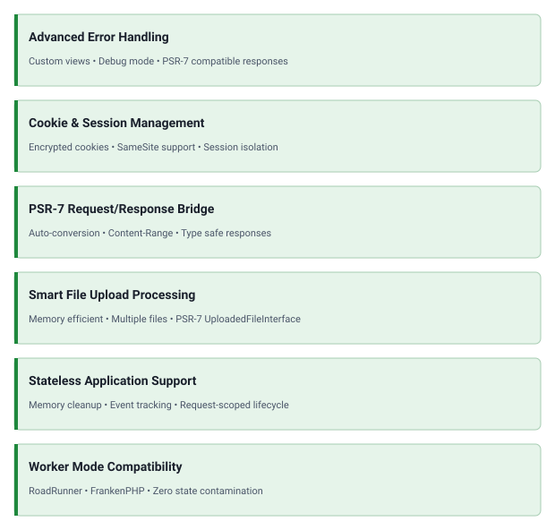

<!-- markdownlint-disable MD041 -->
<p align="center">
    <picture>
        <source media="(prefers-color-scheme: dark)" srcset="https://www.yiiframework.com/image/design/logo/yii3_full_for_dark.svg">
        <source media="(prefers-color-scheme: light)" srcset="https://www.yiiframework.com/image/design/logo/yii3_full_for_light.svg">
        
    </picture>
    <h1 align="center">PSR bridge</h1>
    <br>
</p>
<!-- markdownlint-enable MD041 -->

<p align="center">
    <a href="https://github.com/yii2-extensions/psr-bridge/actions/workflows/build.yml" target="_blank">
        
    </a>
    <a href="https://dashboard.stryker-mutator.io/reports/github.com/yii2-extensions/psr-bridge/main" target="_blank">
        
    </a>
    <a href="https://github.com/yii2-extensions/psr-bridge/actions/workflows/static.yml" target="_blank">
        
    </a>
    <a href="https://github.com/yii2-extensions/psr-bridge/actions/workflows/security.yml" target="_blank">
        
    </a>
</p>

<p align="center">
    <strong>Transform your Yii2 applications into high-performance, PSR-compliant powerhouses</strong><br>
    <em>Supporting traditional SAPI, RoadRunner, FrankenPHP, and worker-based architectures</em>
</p>

Run a Yii application with PSR-7 requests and responses, including long-running workers. The bridge provides a
PSR-15 request handler, Yii request/response adapters, upload conversion, and a streaming SAPI emitter.

## Available deployment options

### High-Performance Worker Mode

Long-running PHP workers for higher throughput and lower latency.

[](https://github.com/yii2-extensions/franken-php)
[](https://github.com/yii2-extensions/road-runner)

## Features

<picture>
    <source media="(min-width: 768px)" srcset="./docs/svgs/features.svg">
    
</picture>

### Installation

Requires the `filter` and `mbstring` PHP extensions. Install a PSR-7/PSR-17
implementation alongside the bridge; the example uses HttpSoft. This example requires the unreleased 0.4
`finalize()` lifecycle, so select `dev-main` explicitly:

```bash
composer require yii2-extensions/psr-bridge:dev-main httpsoft/http-message
```

`dev-main` is a moving development branch, not a stable 0.4 release. Review and retain the resolved commit in
`composer.lock`; the stable 0.3 release does not provide `Application::finalize()`. See [installation](docs/installation.md).

### Quick start

In an existing Yii application, use this entry script in place of the usual `Application::run()`. The example
assumes `web/index.php`, Composer dependencies, and the application's `config/web.php` with its routes and secret
`request.cookieValidationKey` already configured.

```php
<?php

declare(strict_types=1);

use HttpSoft\Message\{ResponseFactory, ServerRequestFactory, StreamFactory, UploadedFileFactory};
use Psr\Http\Message\{ResponseFactoryInterface, StreamFactoryInterface};
use yii2\extensions\psrbridge\creator\ServerRequestCreator;
use yii2\extensions\psrbridge\emitter\SapiEmitter;
use yii2\extensions\psrbridge\http\Application;

ini_set('session.use_cookies', '0');

require dirname(__DIR__) . '/vendor/autoload.php';
require dirname(__DIR__) . '/vendor/yiisoft/yii2/Yii.php';

$config = require dirname(__DIR__) . '/config/web.php';

$config['container']['definitions'][ResponseFactoryInterface::class] = ResponseFactory::class;
$config['container']['definitions'][StreamFactoryInterface::class] = StreamFactory::class;

$app = new Application($config);
$creator = new ServerRequestCreator(new ServerRequestFactory(), new StreamFactory(), new UploadedFileFactory());

$request = $creator->createFromGlobals();
$response = $app->handle($request);

$emitted = false;

try {
    (new SapiEmitter())->emit($response, $request->getMethod() !== 'HEAD');
    $emitted = true;
} finally {
    $app->finalize($emitted);
}
```

`Application` supplies the bridge request, response, and error handler by default. For a worker, create the
application once and repeat `handle()`, runtime emission, then `finalize()` for each request. Keep file streams
open until emission completes. A PSR-15 host must arrange this extra finalization step.

### Worker lifecycle defaults

`useSession=false` skips eager session opening around bootstrap; session IDs are still isolated on every request.
Keep request-scoped components out of `persistentComponents`.

### Smart Body Parsing

See the configuration guide before changing lifecycle settings or handling JSON bodies created from SAPI globals.

## Documentation

Practical guides and complete examples for PSR-7 integration and the worker
lifecycle.

- 📚 [Installation and Runtime Choices](docs/installation.md)
- ⚙️ [Configuration and Request Isolation](docs/configuration.md)
- 💡 [Worker Lifecycle, JSON, Uploads, and Downloads](docs/examples.md)
- 🔄 [Upgrade Guide](UPGRADE.md) and [Migration Checks](docs/migration.md)
- 🧪 [Testing Guide](docs/testing.md)

## AI assistance

AI agents: use the repository guides and source for the installed revision.
For a [documentation deployment](https://yii2-framework.github.io/docs/) with
`llms.txt`, read that index first. When Markdown export is enabled, append
`index.md` to a page URL. For Yii conventions, use the `yii2-framework` skill
from a local framework documentation checkout.

- 🤖 [yii2-psr-bridge-worker skill](docs/agents.md): installation for Claude Code, Codex, and OpenCode.

If the hosted sources are unavailable, use the repository guides and locally available skills.

## Package information

[](https://www.php.net/releases/8.3/en.php)
[](https://github.com/yiisoft/yii2/releases/tag/2.0.55)
[](https://github.com/yiisoft/yii2/tree/22.0)
[](https://packagist.org/packages/yii2-extensions/psr-bridge)
[](https://packagist.org/packages/yii2-extensions/psr-bridge)

## Project status

[](https://codecov.io/github/yii2-extensions/psr-bridge)
[](https://github.com/yii2-extensions/psr-bridge/actions/workflows/static.yml)
[](https://github.com/yii2-extensions/psr-bridge/actions/workflows/quality.yml)
[](https://github.styleci.io/repos/1019044094?branch=main)

## Our social networks

[](https://x.com/Terabytesoftw)
[](https://www.facebook.com/wilmer.arambula.9)
[](https://www.reddit.com/r/Yii2/)
[](https://t.me/yii_framework_in_english)

## License

[](LICENSE)
